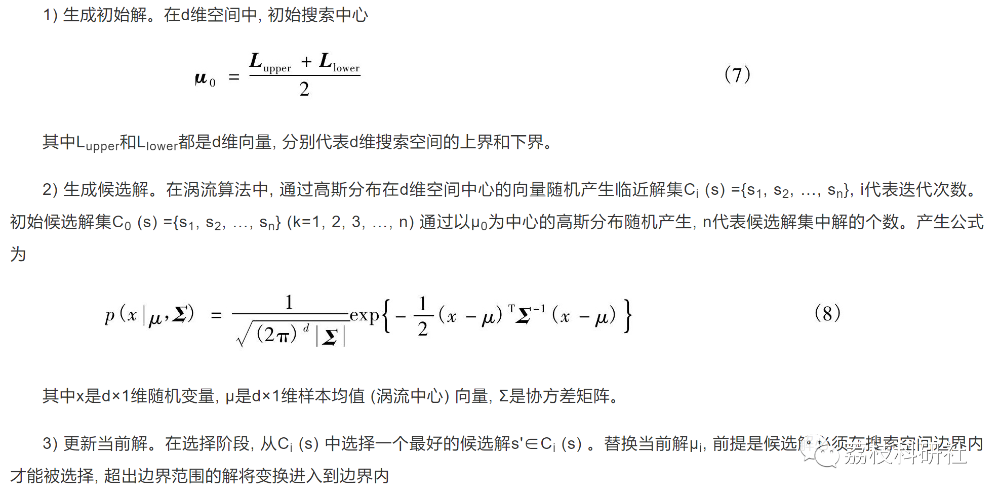
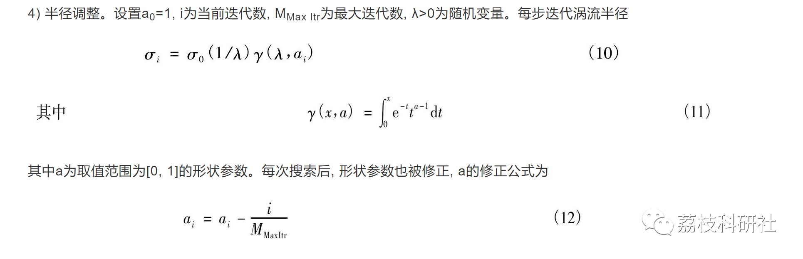
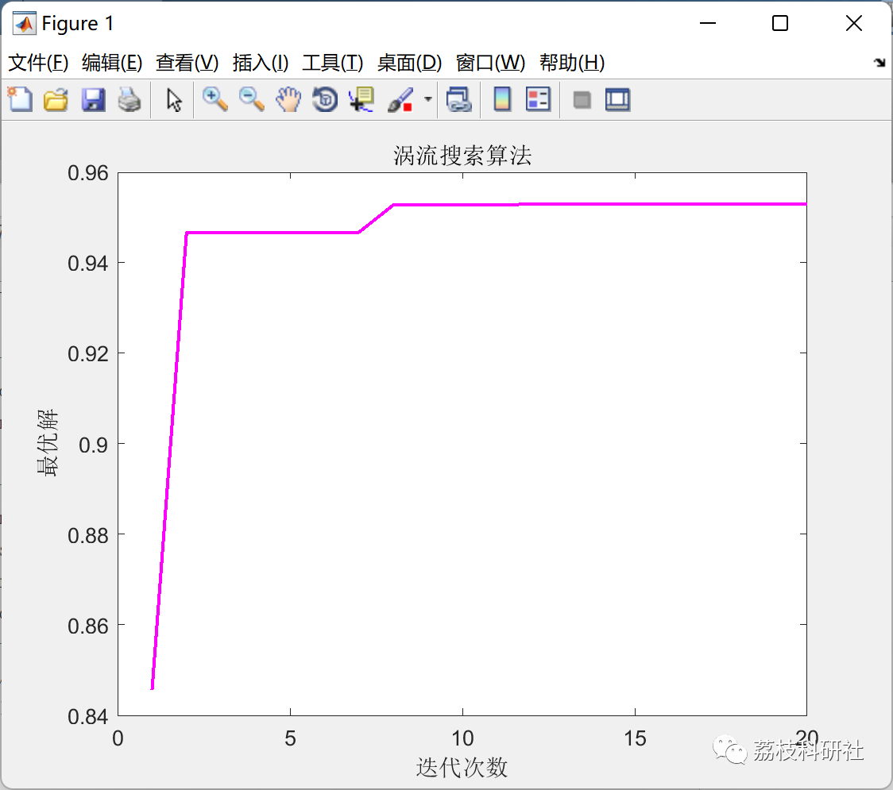

# Electromagnetic Search Algorithm (Matlab Code Implementation)

💥💥💥💞💞💞 Welcome to this blog❤️❤️❤️ 💥💥💥
🏆 Bloggers' Advantages: 🌞🌞🌞 The content of the blog strives for rigorous thinking and clear logic to facilitate readers.
⛳️ Mantra: A journey of a thousand miles begins with a single step.
Litchi Research Society
Code Collection: Power Systems, Intelligent Algorithms and Applications, Neural Network Prediction, Path Planning, Optimized Scheduling, Workshop Scheduling, Image Processing, Signal Processing, etc.
🎁 Column Directory Link:
🌈🌈🌈🌟🌟🌟 Electrical Code Intelligent Algorithms and Their Applications Path Planning Neural Network Prediction Optimized Scheduling Image Processing Workshop Scheduling Signal Processing Romantic Her Thoughts Math Modeling Complete Code Issues
💥1 Overview
The search behavior of the vortex search algorithm simulates the phenomenon of vortices, using a large radius for exploration in the initial stage, and then switching to small-radius local development when entering the local solution area.
Below are the steps explained:
📚2 Run Results
🎉3 References
[1] Li Panchi, Lu Aiping. Quantum Derivative Vortex Search Algorithm [J]. Control and Decision, 2016, 31(06):990-996. DOI:10.13195/j.kzyjc.2015.0595.
[2] Li Xuegui, Xu Shaohua, Li Na, Zhao Entao, Guo Hao. Process Support Vector Regression Machine Model Based on Vortex Search Algorithm [J]. Journal of Jilin University (Information Science Edition), 2017, 35(03):341-346. DOI:10.19292/j.cnki.jdxxp.2017.03.018.
🌈4 MATLAB Code Realization
Click the article below left bottom [Read Full Content]

## Images

<!-- PAYMENT_BLOCK -->

## Get this dataset

- Payment link (Stripe): [Buy now](https://buy.stripe.com/3cs8yP7sY87d0vu9AB)
- Payment QR code: 

<!-- /PAYMENT_BLOCK -->
